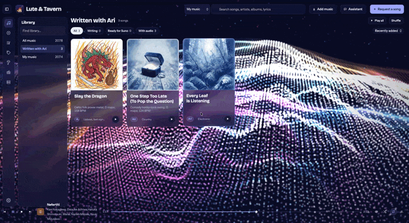
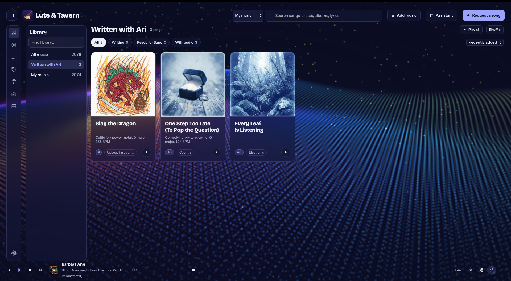
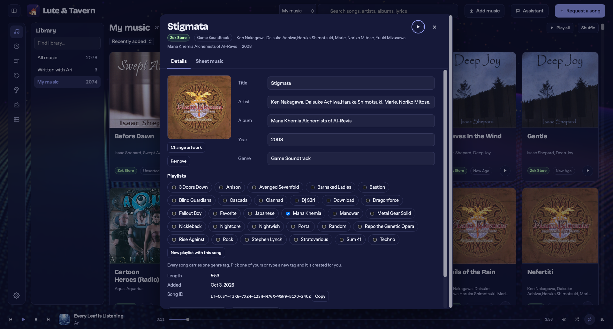
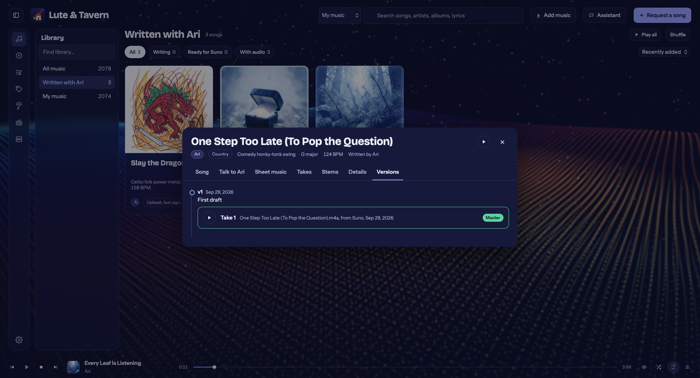
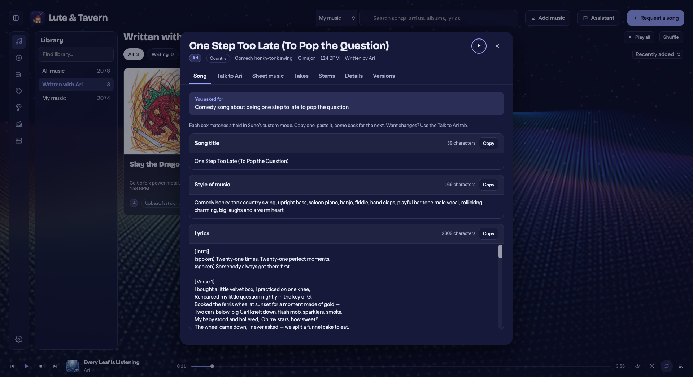
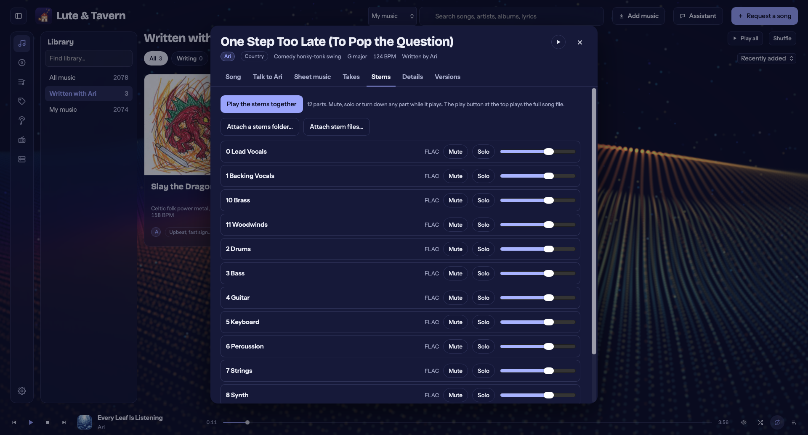
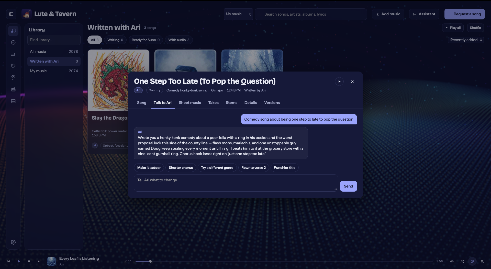
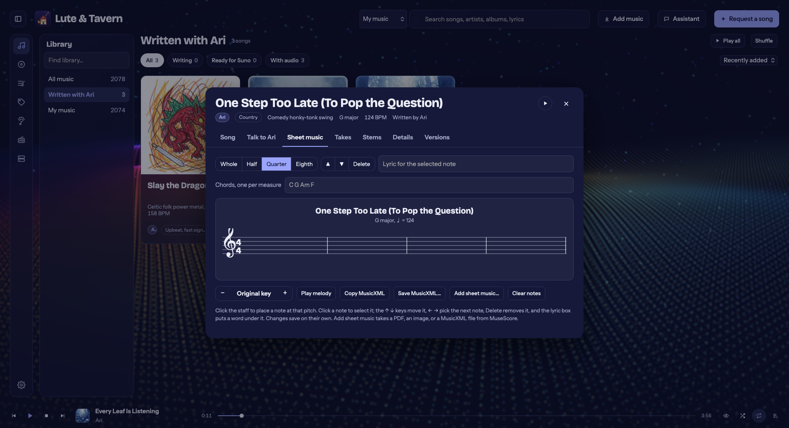
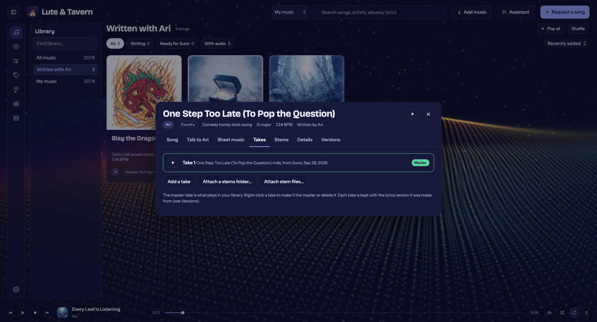
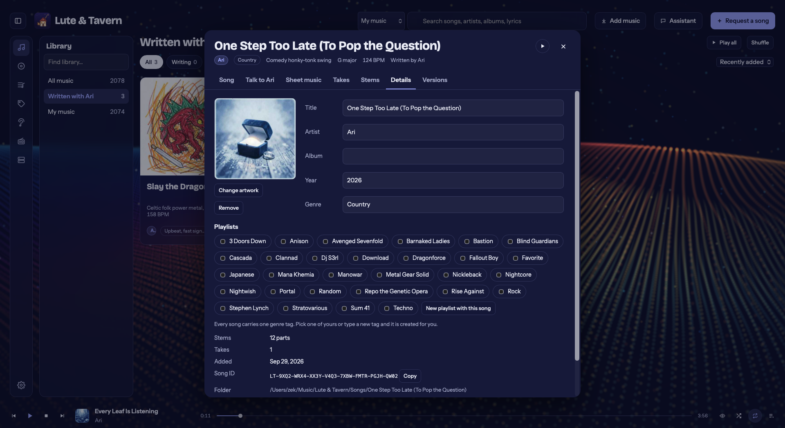

# Lute & Tavern

A desktop music app: your music library, an AI songwriter, and sheet music in one place.

- **A tidy library.** Drop songs in and each gets its own folder with its stems, takes, sheet music, cover and a `song.json` of everything the app knows. Other artists' albums stay together as Artist/Album.
- **Your music.** Point it at your other music folders too. Songs are read from their own tags (title, artist, album, year, genre, cover art) and the folders stay in sync as you add, change or delete files.
- **Genre tags.** Every song carries one genre tag. Built-in tags make picking quick, you can create your own, and tags from your files and from the songwriter join the list.
- **Playlists, queue and repeat.** Build playlists, reorder what plays next, repeat a playlist or a single song.
- **A songwriter.** Describe a song and an AI of your choice writes the lyrics, a Suno style prompt and a chorus melody. Ask for changes in plain words; every rewrite is kept as a version. Works with any OpenAI-compatible server, local or hosted.
- **Sheet music.** Write a melody by clicking on the staff, attach PDFs or images of sheet music, and import or export MusicXML for MuseScore.
- **A living background** that swells with whatever is playing, and visualizer **shows**: a song's own choreography (beats, drum hits, bass, voice, sections) worked out once by the optional show analyzer. Settings › Shows walks through the one-time setup; after that the app makes shows by itself.
- **Your music services.** Stream from your own music server (Subsonic / Navidrome, Jellyfin, Plex, or a WebDAV folder such as Nextcloud), play Apple Music with your subscription, and listen to internet radio (Radio Browser).
- **Sync and backup** with the sync app you already use, and an assistant you can talk to (Cmd/Ctrl+J).

Sign-ins, keys and tokens are kept in your system's key store (macOS Keychain, Windows Credential Manager, Secret Service on Linux), never in the app's files.

## Download

Installers for macOS (Apple Silicon) and Linux (.deb, .rpm, AppImage) are on the [Releases](../../releases) page.

## Screenshots




| | |
|---|---|
|  |  |
|  |  |
|  |  |
|  |  |
|  | |

## Layout

See [docs/STRUCTURE.md](docs/STRUCTURE.md). In short: `crates/lt-core` is the engine (database, tags, folders, songwriter), `apps/desktop` is the Tauri app that puts a face on it.

## Build

Requirements: Rust (stable), Node 20+, and on macOS the Xcode command line tools.

```sh
cd apps/desktop
npm install
npm run tauri dev      # run in development
npm run tauri build    # produce the app bundle (macOS: .app and .dmg under target/release/bundle)
```

On a Mac, run the build script in Terminal (not over SSH, since signing needs your keychain):

- `scripts/dev-mac.sh` runs a live development copy that picks up changes on its own (interface instantly, Rust after a rebuild). This is how changes are tried day to day.
- `scripts/build-mac.sh` makes a signed local build of the app in /Applications.
- `scripts/build-mac.sh --release` is for version milestones: Developer ID signature, Apple notarization, a disk image, built-in Apple Music access and in-app update files. See the notes at the top of the script.

On Linux, `scripts/build-linux.sh` builds the .deb, .rpm and AppImage (needs the WebKitGTK 4.1 development libraries).

Builds carry no paths or names from the computer that made them (`scripts/clean-paths.sh`). Releases are sent to an update server of your choice with `scripts/publish-update.sh`.

In-app updates are built in but off by default; each person turns them on in Settings, and only official releases can update themselves.

Tests: `cargo test --workspace` from the repository root.

## Status

Version 0.1: library, folders, playlists, queue, genre tags, songwriter, sheet editor, music services, visualizer shows. See [docs/ROADMAP.md](docs/ROADMAP.md) for what comes next.

## License

Free for personal use: listening, hobby and amateur music-making, study, and testing. Charities, schools, public research groups and government bodies may use it free too. Businesses and corporations may not use it, in whole or in part, without the author's permission.

Lute & Tavern is licensed under the [PolyForm Noncommercial License 1.0.0](LICENSE.md). For commercial use, contact the author through GitHub.

The optional show analyzer installs open-source tools from their makers under their own licenses (see Settings › Shows › Made with).
